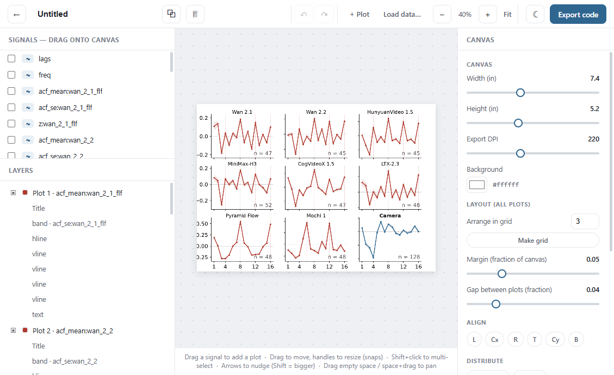
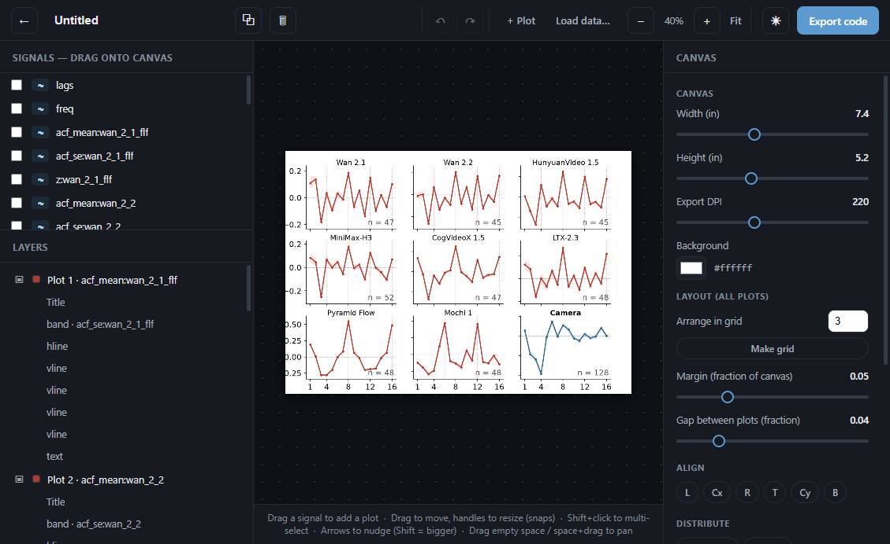
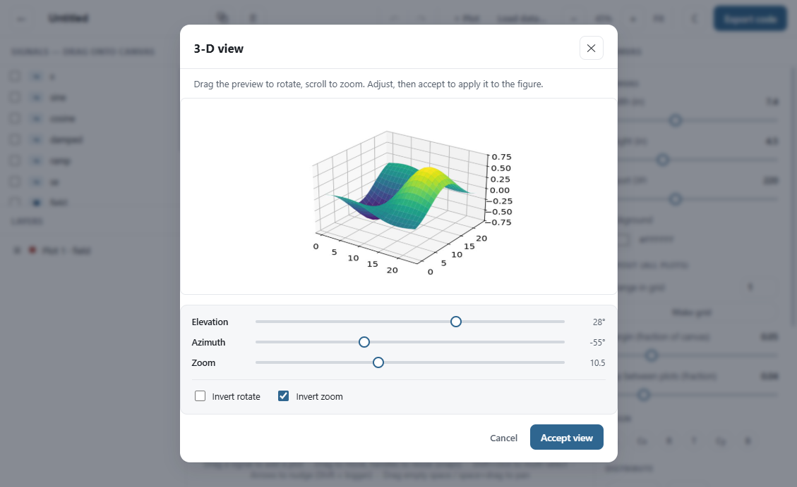
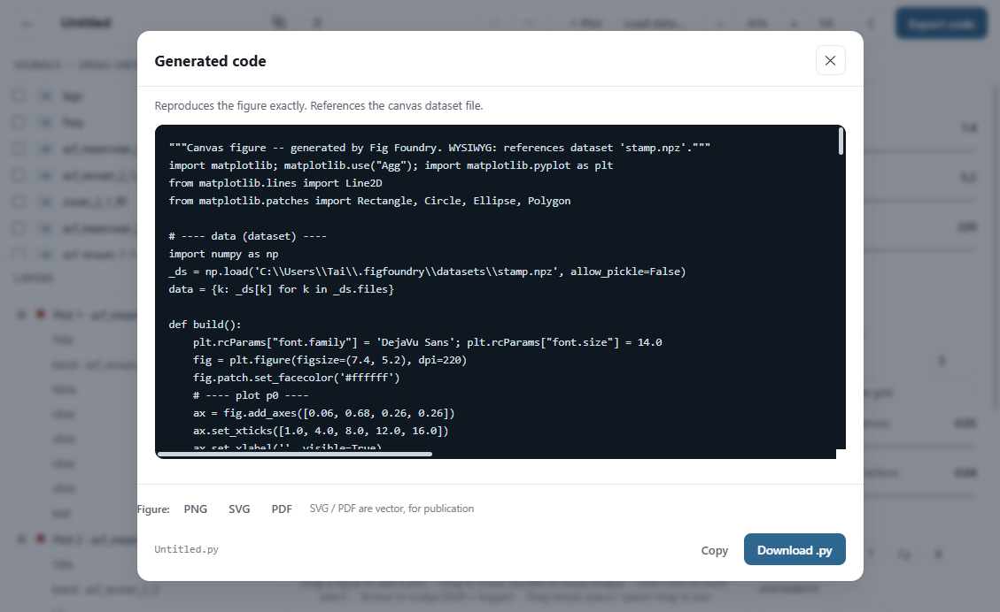
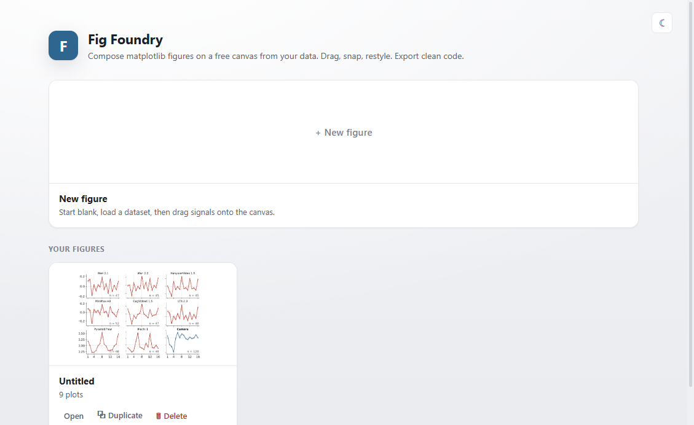
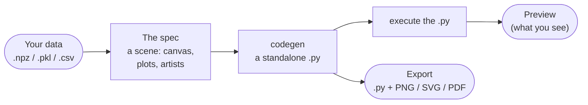

<p align="center">
  
</p>

<h1 align="center">Fig Foundry</h1>

<p align="center">
  <b>A WYSIWYG figure studio for matplotlib.</b><br>
  Drag your data onto a free canvas, compose publication figures, and export the
  exact Python that draws them. The preview is the generated code, executed — so
  what you see is what the <code>.py</code> produces.
</p>

<p align="center">
  <a href="https://pypi.org/project/figfoundry/"></a>
  <a href="LICENSE"></a>
  
  
</p>

<p align="center">
  <a href="#install"><b>Install</b></a> ·
  <a href="#a-quick-tour">Tour</a> ·
  <a href="#measured-not-claimed">Measured</a> ·
  <a href="#how-it-works">How it works</a> ·
  <a href="#command-line">Command line</a>
</p>

<p align="center">
  
</p>
<p align="center">
  <sub>A nine-panel figure composed on the canvas from one dataset's signals. Every panel
  is a real matplotlib <code>Axes</code> placed by explicit coordinates, so it can sit
  anywhere, at any size.</sub>
</p>

You have the data; Fig Foundry is the table you lay it out on. Load a dataset, drag a
signal onto the canvas and it becomes a plot. Move and resize plots with snapping, nudge
and style each one in the inspector, add the second series or the σ-band, and when it is
right, export the code. Because the preview is rendered by running that very code, there is
no "close enough" — the figure you arrange and the script you ship are the same drawing.

<table>
  <tr>
    <td width="50%" valign="top">
      <b>WYSIWYG by construction</b><br>
      One drawing path. The browser preview executes the generated <code>.py</code>, so the
      export is byte-for-byte what you see. There is no second renderer to drift.
    </td>
    <td width="50%" valign="top">
      <b>The atom is data</b><br>
      A figure is a scene of plots over named signals. Drag a signal to make a plot; drop it
      on one to overlay a line, a σ-band, or error bars. Nothing is hand-drawn.
    </td>
  </tr>
  <tr>
    <td width="50%" valign="top">
      <b>Twenty-three plot types</b><br>
      Line, step, scatter, grouped scatter, bar, box, violin, histograms, hexbin, image,
      contour, pcolormesh, vector fields, streamplot, decision boundary, pie, polar, and
      three 3-D types.
    </td>
    <td width="50%" valign="top">
      <b>Private, on your machine</b><br>
      A local web app. Your datasets, figures and exports live in <code>~/.figfoundry</code>;
      nothing you load is sent anywhere. Pickle files load through a whitelist, not a
      deserializer.
    </td>
  </tr>
</table>

## A quick tour

<p align="center">
  
</p>
<p align="center"><b>Light, dark, or your system's.</b> The interface re-skins; the figure
itself stays on a white artboard, so the artwork is publication-clean in either theme.</p>

<p align="center">
  
</p>
<p align="center"><b>3-D, to your angle.</b> Double-click a 3-D plot to open the viewfinder:
drag to rotate, scroll to zoom, or use the sliders. Accept writes the camera back to the
figure and, with it, into the exported code.</p>

<table>
  <tr>
    <td width="50%" valign="top">
      
      <p><b>Export the code and the figure.</b> The standalone <code>.py</code>, plus the
      figure as PNG, SVG or PDF — SVG and PDF are vector, for the paper.</p>
    </td>
    <td width="50%" valign="top">
      
      <p><b>Your figures.</b> Every canvas is saved with a live thumbnail; open, duplicate
      or delete from here. Each one is tied to the dataset it was built from.</p>
    </td>
  </tr>
</table>

## Measured, not claimed

Every figure below is reproducible from the repository: the test suite, the CI runs, and the
security probes.

| | |
|---|---|
| Plot types, each verified preview-identical to its export | **23 of 23** ([tests](tests/test_plot_types.py)) |
| Tests, passing on Linux and Windows, Python 3.10 and 3.12 | **152** ([CI](https://github.com/ductai199x/figfoundry/actions)) |
| Malicious pickle payloads the whitelist refuses to load | **18**, including `np.fromfile`, `np.load`, `__import__`, `eval`, `exec` ([tests](tests/test_data_app.py)) |
| Separate renderers the export can drift from | **0** — the preview executes the export |

## What it does

- **Composes on a free canvas.** Plots are explicit rectangles, not a fixed grid, so they
  go anywhere and at any size. Move, resize with snapping, nudge with the arrow keys, and
  multi-select (Shift+click) to move, nudge or delete a group at once.
- **Twenty-three plot types.** Line, step, scatter, grouped scatter (color-by-class), bar and
  horizontal bar, histogram, box plot, violin plot, 2-D histogram, hexbin, image, contour
  (filled and lines), pcolormesh, vector field, streamplot, decision boundary (a surface with
  the points on top), pie, polar, 3-D scatter, 3-D surface and 3-D wireframe.
- **Styles every element.** Per plot: the data, plot type, color, line and marker, σ-band and
  error bars, ticks and tick labels, limits and scale, spines, title, colormap and colorbar,
  and artists — vertical and horizontal lines, text, annotations, arrows, boxes, circles,
  ellipses, polygons and legends. Figure-level axis labels, legend, suptitle and free text.
- **Suggests accessible color.** One click applies the colorblind-safe Okabe–Ito palette to a
  plot's series; a palette menu (Okabe–Ito, Bright, Viridis, Plasma, Cividis) is available
  through the API.
- **Speaks LaTeX.** Labels, titles and text take mathtext, so `$x_0$` and `$\alpha$` render.
- **Lays out for you.** Arrange in a grid, align and distribute a selection, set margins and
  gaps, and sync axis ranges across every plot at once.
- **Exports clean code.** The figure as a standalone <code>.py</code> that references the
  dataset, plus the rendered figure as PNG, SVG or PDF. The 3-D camera, the colors, the
  ticks — all of it is in the code.
- **Remembers your setup.** Themes, and the 3-D rotate/zoom direction, persist; figures,
  datasets and exports live in <code>~/.figfoundry</code>.

## How it works



- **One path, both ends.** `codegen_canvas` turns the spec into a plain <code>.py</code> — a
  list of <code>fig.add_axes([...])</code> calls over the dataset. The preview is that file,
  run; the export is that file, saved. They cannot disagree, because they are the same code.
- **The spec is the source of truth.** A figure is a JSON scene (canvas, plots, artists). The
  browser edits it; the backend renders it by executing the generated code. Save it and it is
  a canvas you can reopen, duplicate and drive over the API.
- **Data stays data.** Signals are arrays, referenced by name. The exported code loads the
  dataset and indexes it — the numbers in the figure are the numbers in your file, unedited.

## Data

A *dataset* is a named set of signals (arrays), 1-D and 2-D. Load one with **Load data…**
(pick an existing dataset, or upload a file):

- **`.npz`** — a numpy zip of named arrays. Safe by construction.
- **`.pkl`** — a Python pickle, loaded through a **whitelist unpickler** that permits only
  numpy arrays and plain containers. A pickle that tries to run code — `os`, `subprocess`,
  `eval`, `np.fromfile` and the rest — is refused, not executed.
- **`.csv`** — a table with a header row; each numeric column becomes a signal.

## Command line

The same engines run from the shell, for scripting and automation:

```
figfoundry            # start the web app (default)
figfoundry serve      # ...with flags: --port, --host, --no-browser
figfoundry list       # list saved figures
figfoundry new        # create a blank figure, print its slug
figfoundry export SLUG [--out PATH]        # write a figure's .py
figfoundry render SLUG [--format png|svg|pdf] [--out PATH]
figfoundry datasets   # list available datasets
```

## Install

From [PyPI](https://pypi.org/project/figfoundry/), with [uv](https://docs.astral.sh/uv/):

```sh
uv tool install figfoundry      # puts the `figfoundry` command on your PATH
figfoundry                      # → opens http://127.0.0.1:8037
```

Or:

```sh
pip install figfoundry
# or from this repository:
uv tool install figfoundry --from "git+https://github.com/ductai199x/figfoundry.git"
```

Python 3.10 or newer. It runs wherever Python and a browser do.

<details>
<summary>Development</summary>

```sh
uv sync --extra dev
uv run --extra dev pytest -q          # 152 tests
uv run --with ruff ruff check .       # lint
uv run figfoundry serve               # the app
```

The suite covers the WYSIWYG invariant for every plot type, the pickle whitelist, dataset I/O
(npz/pkl/csv), vector export, the CLI, and the API through a test client. CI runs it, plus the
build and an artifact check, on Linux and Windows for Python 3.10 and 3.12
([.github/workflows/ci.yml](.github/workflows/ci.yml)).

</details>

## License

Copyright (C) 2026 Tai Duc Nguyen.

Fig Foundry is licensed under the [MIT License](LICENSE): use it, study it, change it and
share it. The one sample dataset it ships is synthetic; your own data never leaves your
machine.
